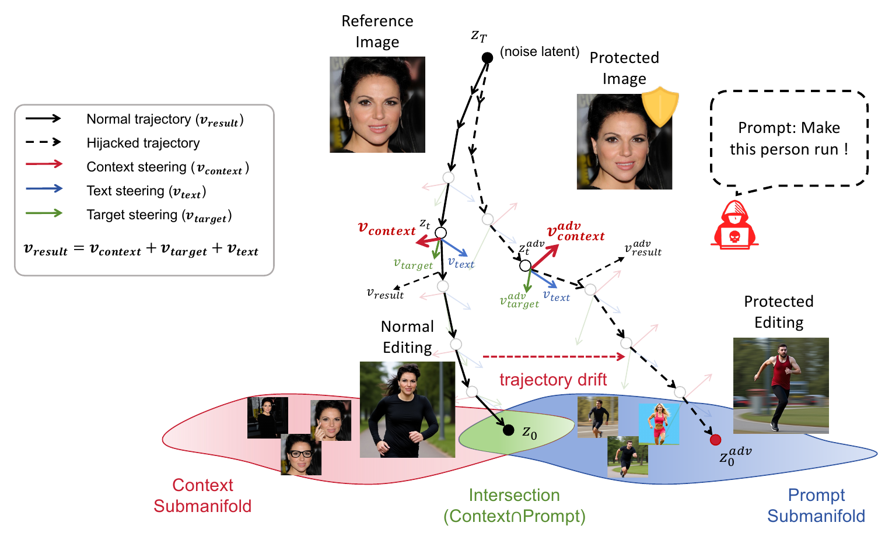
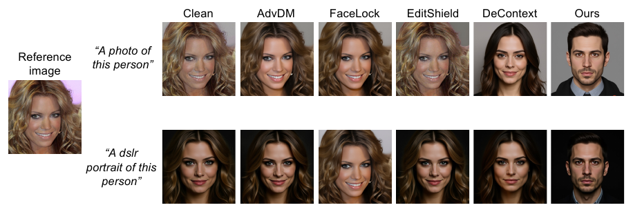

<h1 align="center">
  Escape the Context Manifold:<br>
  Preventing DiT In-Context Editing<br>
  via Conditional Flow Hijacking
</h1>

<h3 align="center">NeurIPS 2026</h3>

<h3 align="center">
  <a href="https://anson-he.github.io/">Yuhao He</a> &nbsp;&middot;&nbsp;
  <a href="https://jinyutian.github.io/">Jinyu Tian</a><sup>*</sup>
</h3>

<h3 align="center">Macau University of Science and Technology</h3>

<p align="center"><sup>*</sup> Corresponding author</p>

We introduce **Conditional Flow Hijacking**, a proactive protection method for DiT-based in-context image editing. Small perturbations to the reference image redirect context-induced steering, driving the editing trajectory away from the original context manifold while preserving prompt alignment and visual realism.

<p align="center">
  <a href="assets/insight.png">
    
  </a>
</p>

## Installation

Use Linux, Python 3.10, and an NVIDIA GPU. The dependencies select CUDA 12.8 builds of PyTorch and torchvision; a compatible NVIDIA driver is required. The implementation has been tested on an RTX A6000 with 48 GB VRAM.

```bash
conda create -n manifoldhijack python=3.10 pip -y
conda activate manifoldhijack
python -m pip install -r requirements.txt
```

The bundled DeepFace evaluator requires the pinned TensorFlow/Keras versions. Do not install a separate `deepface` package. The `openai-clip` package supplies the CLIP implementation.

## Prepare the Model and Images

Place the FLUX.1-Kontext-dev weights in a local directory containing its tokenizers, text encoders, VAE, transformer, and scheduler. Run the following commands from the repository root:

```bash
export MODEL_PATH=/path/to/FLUX.1-Kontext-dev
export USE_TF=0
export USE_FLAX=0

mkdir -p data/input
cp /path/to/170.jpg data/input/170.jpg
```

Use your own input images. The supplied `assets/logo.png` is the default hijack target. For offline use with complete local weights, additionally set `HF_HUB_OFFLINE=1` and `TRANSFORMERS_OFFLINE=1`.

## Protect Images

```bash
python attack/attack_Flux_Kontext/attack_manifold_hijack_hook.py \
  --pretrained_model_name_or_path "$MODEL_PATH" \
  --condition_images_dir data/input \
  --output_dir outputs/perturbed \
  --hijack_mode image \
  --hijack_image_path assets/logo.png \
  --attack_steps 200 \
  --alpha 0.005 \
  --eps 0.1 \
  --num_attack_layers 25 \
  --resolution 512 \
  --mixed_precision bf16 \
  --seed 42
```

Protected images are saved as `outputs/perturbed/adversarial_<image_id>.png`. The script includes its optimization prompt pool. The perturbation budget `eps` is defined on images normalized to `[-1, 1]`.

**Implementation note:** the current code samples the attention-loss weight uniformly from `[0.001, 0.01]` per iteration, overriding `--lambda_attn`; the paper reports a fixed weight of `0.005`.

## Single-Image Editing

```bash
python inference/kontext_inference.py \
  --model_path "$MODEL_PATH" \
  --context_image outputs/perturbed/adversarial_170.png \
  --prompt "a photo of this person" \
  --output_dir outputs/edited \
  --num_inference_steps 20 \
  --width 512 \
  --height 512 \
  --seed 42
```

The edited image is saved as `outputs/edited/adversarial_170_output.png`.

## Evaluation

**Identity similarity (ISM) and face-detection failure rate (FDFR).** Run the TensorFlow evaluator on CPU:

```bash
CUDA_VISIBLE_DEVICES="" python evaluate/ism_pairwise.py \
  --src_dir data/input \
  --tgt_dir outputs/edited
```

Images are paired by numeric ID. ISM averages ArcFace cosine similarity over successfully detected pairs. Check the per-image messages: this implementation counts missing matches and source or target extraction failures toward its reported FDFR.

**CLIP score.** Use the same prompt as in editing:

```bash
python evaluate/compute_clipscore.py \
  --img_dir outputs/edited \
  --prompt "a photo of this person" \
  --device cuda
```

**CLIP-IQA:**

```bash
python evaluate/compute_clipiqa.py \
  --img_dir outputs/edited \
  --device cuda
```

All metrics are printed to the terminal. The evaluators use ArcFace/RetinaFace, CLIP ViT-B/32, and PIQ's CLIP-IQA. Their pretrained weights are downloaded on first use unless already cached under `~/.deepface/weights/` and `~/.cache/clip/`.

## Selected Results

### Qualitative Comparison

<p align="center">
  <a href="assets/qualitative-results.png">
    
  </a>
</p>

Comparison under two editing prompts (Figure 5 in the paper). Our method changes the reference identity while producing prompt-consistent edited images.

### Identity Protection on CelebA-HQ

Results from Table 1 for the prompt **"a photo of this person"**. ISM measures identity preservation (lower is better for protection); CLIP-IQA measures image quality and CLIP-Score measures prompt alignment (higher is better).

<table align="center">
  <thead>
    <tr>
      <th align="center">Method</th>
      <th align="center">FDFR</th>
      <th align="center">ISM ↓</th>
      <th align="center">CLIP-IQA ↑</th>
      <th align="center">CLIP-Score ↑</th>
    </tr>
  </thead>
  <tbody>
    <tr>
      <td align="center">Clean</td>
      <td align="center">0.00</td>
      <td align="center">0.89</td>
      <td align="center"><strong>0.78</strong></td>
      <td align="center">24.13</td>
    </tr>
    <tr>
      <td align="center">AdvDM</td>
      <td align="center">0.00</td>
      <td align="center">0.86</td>
      <td align="center">0.59</td>
      <td align="center">24.42</td>
    </tr>
    <tr>
      <td align="center">FaceLock</td>
      <td align="center">0.00</td>
      <td align="center">0.85</td>
      <td align="center">0.70</td>
      <td align="center">24.27</td>
    </tr>
    <tr>
      <td align="center">EditShield</td>
      <td align="center">0.00</td>
      <td align="center">0.92</td>
      <td align="center">0.72</td>
      <td align="center">24.20</td>
    </tr>
    <tr>
      <td align="center">DeContext</td>
      <td align="center">0.00</td>
      <td align="center">0.39</td>
      <td align="center">0.70</td>
      <td align="center">25.93</td>
    </tr>
    <tr>
      <td align="center"><strong>Ours</strong></td>
      <td align="center">0.00</td>
      <td align="center"><strong>0.11</strong></td>
      <td align="center">0.72</td>
      <td align="center"><strong>26.58</strong></td>
    </tr>
  </tbody>
</table>

## Citation

If you find this work useful, please cite:

```bibtex
@inproceedings{he2026escape,
  title     = {Escape the Context Manifold: Preventing {DiT} In-Context Editing via Conditional Flow Hijacking},
  author    = {Yuhao He and Jinyu Tian},
  booktitle = {The Fortieth Annual Conference on Neural Information Processing Systems},
  year      = {2026},
  url       = {https://openreview.net/forum?id=06nMkjyRaB}
}
```
